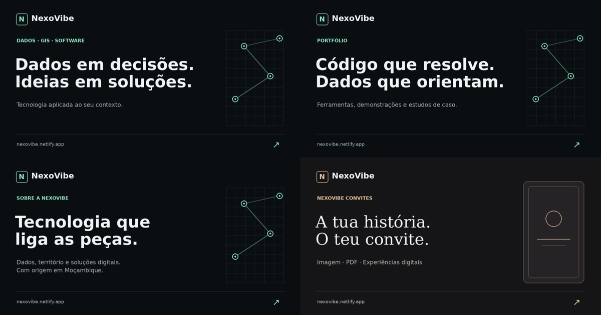

# Previews de partilha

Cartões PNG estáticos de 1200 × 630 para a página inicial, portfólio, Sobre,
convites, relatório demonstrativo e os três estudos de caso. Cada página tem
Open Graph e Twitter Card com título, descrição, URL e imagem próprios.
As páginas inglesas usam imagens inglesas. A formação também tem previews PT/EN.

Os ficheiros encontram-se em `public/social/pt` e `public/social/en`.
O helper `src/lib/share.ts` preserva a origem definida em `metadataBase`.
O domínio continua a ser `nexovibe.netlify.app`, conforme a configuração actual.
Links com fragmentos, como `/#contacto` e `/#servicos`, usam o preview da página
inicial: os crawlers não recebem o fragmento no pedido HTTP.

Para regenerar as imagens, instalar Pillow e DejaVu Sans/Serif e executar
`python scripts/generate-social-previews.py` na raiz. Pode definir
`SOCIAL_FONT_DIR` para outra pasta com os mesmos ficheiros de fonte.
Não há dependência de Python ou geração de imagens no deploy.

As redes sociais mantêm caches dos previews; alterações podem exigir nova
recolha da URL pela plataforma. A apresentação final depende do cliente.
Não foram enviados links ou mensagens a terceiros para testar.
